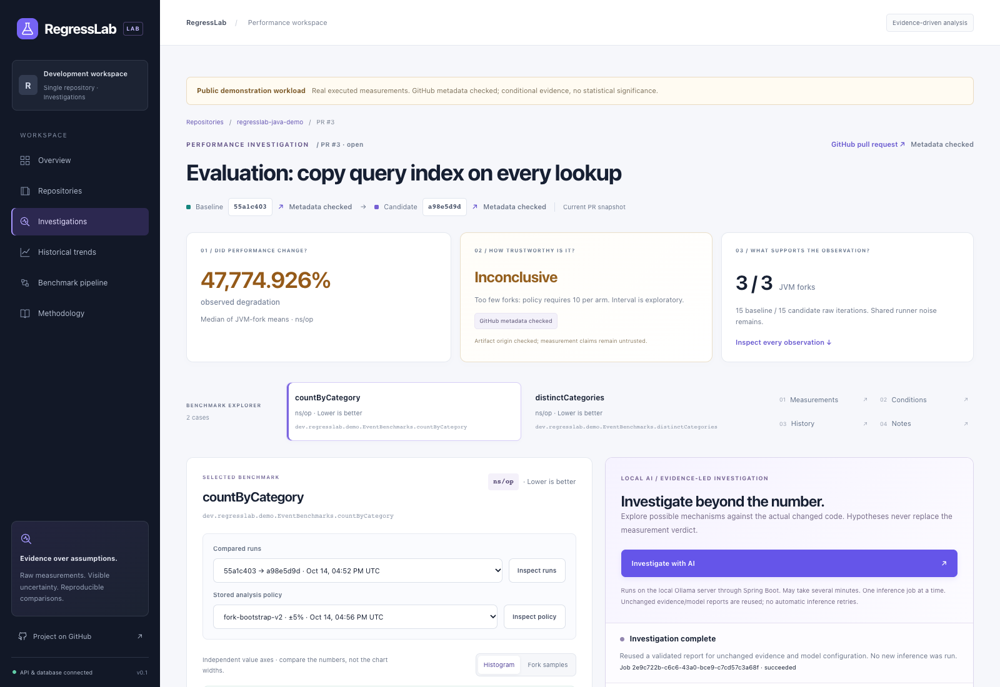
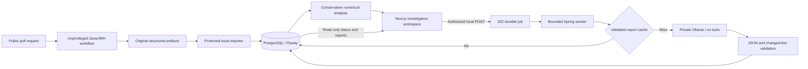

# RegressLab

RegressLab is a performance regression investigation tool for Java projects. It
imports JMH benchmark results from GitHub pull requests and displays baseline and
candidate measurements, distributions, history and execution conditions. An optional
Ollama integration links performance hypotheses to changed code.



## Features

- Repository and pull-request dashboard backed by PostgreSQL.
- Individual measurements preserved with JVM-fork and iteration structure.
- Reproducible fork-level bootstrap comparisons with practical thresholds,
  compatibility checks and conservative insufficient-evidence states.
- GitHub artifact validation against repository identity, commit SHAs, workflow
  metadata, original ZIP digests and approved pipeline files.
- Local AI investigations with strict JSON/citation validation, asynchronous jobs,
  bounded concurrency, immutable reports and unchanged-evidence reuse.
- A reproducible controlled evaluation suite with regression and noisy/no-change
  scenarios, real Java/JMH execution and a real PostgreSQL query workload.

RegressLab currently supports one public demonstration repository and local
administration. It has no hosted deployment, organization management or billing.
Uploaded artifacts are data only; neither the API nor the model executes PR code.

## Public demonstration

[Benchmark repository](https://github.com/300-iq/regresslab-java-demo) ·
[PR #3: copy the query index on every lookup](https://github.com/300-iq/regresslab-java-demo/pull/3) ·
[Baseline/candidate workflow](https://github.com/300-iq/regresslab-java-demo/actions/runs/38600700268) ·
[Exact candidate code](https://github.com/300-iq/regresslab-java-demo/blob/a98e5d9d96298137504be7fa4ba01f9e17033482/src/main/java/dev/regresslab/demo/EventStatistics.java#L16)

The screenshot shows real imported demonstration measurements. Three forks per arm
remain **Inconclusive**, even for a large observed effect. Model reports are
unverified hypotheses; code references do not prove causation or experiment quality.
No benchmark data is loaded automatically on a fresh installation.

## Architecture



Java 21, Spring Boot/JDBC, PostgreSQL/Flyway, Next.js/React/TypeScript, Tailwind,
Recharts, Docker Compose and JMH. Direct dependencies and lockfiles are pinned;
see [versions](docs/versions.md).

## Local setup

Requirements: Java 21, Node 24 LTS and real PostgreSQL 17. Ollama is optional for
read-only browsing. The default local model is `qwen3:4b`; install/select a local
model yourself. The application never downloads one.

```sh
npm ci
npm run check
(cd backend && ./gradlew clean test bootJar)
```

Follow the [local setup guide](docs/local-setup.md) for private configuration,
PostgreSQL, Spring, frontend startup and genuine artifact import. It covers native
macOS and the optional Docker Desktop host-network backend. Docker runtime routing
has not been verified on the development host.

No credentials are checked in. Generate passwords/tokens locally, keep `.env`
private and never use `NEXT_PUBLIC_*` for server credentials. Ollama and local
administrative endpoints must remain on loopback; do not publish or tunnel them.

## Tests and evaluation

```sh
npm run check
(cd backend && ./gradlew clean test bootJar)
python3 -m unittest discover -s benchmarks/demo -p 'test_*.py'
python3 -m unittest discover -s evaluation -p 'test_*.py'
mvn -B -ntp -f benchmarks/demo/pom.xml package
java -cp benchmarks/demo/target/test-classes:benchmarks/demo/target/classes dev.regresslab.demo.EventStatisticsTest
# With the API running and a built frontend targeting that same API:
E2E_REQUIRE_API=true npm run test:e2e
```

Backend integration tests launch native PostgreSQL. Browser tests use real endpoints
without production-response interception. Unit/component fixtures
are isolated test inputs. Tests do not need privileged GitHub credentials or Ollama.

For controlled model evaluation, follow [evaluation/README.md](evaluation/README.md):

```sh
npm run evaluate:ai -- --output "$PWD/evaluation/results/my-run"
npm run evaluate:ai -- --score evaluation/results/my-run
```

Evaluation records actual measurements, model configuration/digest, failed outputs,
references, uncertainty and experiment quality. Keyword matching is a triage proxy;
useful hypotheses require explicit qualitative review. Neither model prose nor a
bootstrap interval proves a root cause. Generated evidence remains local and ignored.

Five known high development-tool npm advisory entries remain in the Next lint chain;
the latest production npm audit found zero. Run `npm audit` for current results.

## Documentation

- [Architecture and security boundaries](docs/architecture.md)
- [Backend API](docs/backend-api.md)
- [Artifact contract](docs/artifact-contract.md)
- [GitHub benchmarking and import](docs/github-integration.md)
- [Statistical assumptions and decision rules](docs/statistical-analysis.md)
- [LLM integration and limitations](docs/llm-integration.md)

```text
frontend/       Next.js workspace, typed API contracts and protected local AI bridge
backend/        Spring REST/JDBC, ingestion, analysis, Ollama jobs and Flyway
benchmarks/     Approved public Java/JMH producer and orchestration
contracts/      Versioned artifact schema and isolated contract tests
evaluation/     Trusted controlled benchmark/model evaluation CLI
infra/          PostgreSQL Compose and optional host-network backend
scripts/        Protected import, evaluation and read-only capture utilities
docs/           Setup, architecture, API and analysis policies
```
