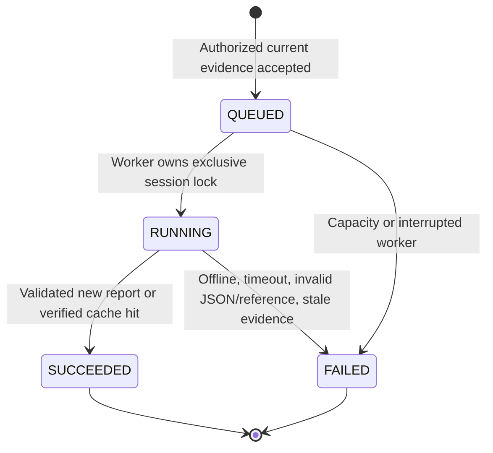

# Architecture: measurements first, hypotheses second

RegressLab is a Java 21/Spring Boot modular monolith, a Next.js/TypeScript frontend,
and PostgreSQL. JMH runs separately in unprivileged GitHub Actions. Ollama runs
natively on the developer's Mac; it never runs PR code or receives database credentials.

```mermaid
flowchart LR
  PR[Public demonstration PR] --> CI[Untrusted pull_request runner\nJava + JMH, contents: read]
  CI --> ZIP[Original structured artifacts\nraw forks and iterations]
  ZIP --> IMPORT[Protected local importer\nsize, schema, identity, SHA and pipeline checks]
  IMPORT --> PG[(PostgreSQL + Flyway\nraw measurements and provenance)]
  PG --> STATS[Deterministic fork-level analysis\nconservative adequacy checks]
  STATS --> WEB[Next.js investigation workspace\ncharts, samples, GitHub links]
  WEB -->|Protected local POST| API[Spring returns 202 + durable job ID]
  API --> JOBS[(Job state in PostgreSQL)]
  JOBS --> WORKER[One bounded worker\nexclusive DB session lock]
  WORKER --> AUTH[Fresh authorized evidence\ncurrent PR/diff, local model identity]
  AUTH --> KEY[Full input + prompt version\nmodel digest + inference configuration]
  KEY --> CACHE{Matching immutable report?}
  CACHE -->|Yes| REUSE[Validate snapshot + citations\nmark job reused]
  CACHE -->|No| OLLAMA[Private loopback Ollama\nbounded JSON chat, no tools]
  OLLAMA --> VALIDATE[Strict parsing and changed-line checks\nprose remains unverified]
  VALIDATE --> SAVE[Short atomic transaction\nreport insert + job success]
  SAVE --> PG
  REUSE --> JOBS
  JOBS -->|Read-only status polling| WEB
```

Completed reports are immutable snapshots; jobs are orchestration records. Success
and a new report insert commit together under READ_COMMITTED. Failure changes only
that job. An interrupted running job is failed after recovery can obtain the worker
lock; fresh queued jobs have a 60-second scheduling grace period. Recovery never
retries model generation automatically.

The unique partial index allows one QUEUED/RUNNING job per database. Identical active
requests return the same job. A bounded single worker and dedicated PostgreSQL session
lock prevent normal overlapping inference across processes using that database.
The lock connection uses autocommit: there is no open DB transaction while calling
GitHub or Ollama. The application cannot control other applications/independent
DB deployments sharing the daemon; configure Ollama's own parallel/model limits too.

Cached reuse still checks repository authorization/current GitHub diff and installed
model identity. SHA pairs alone are insufficient: raw observations, analysis/policy,
environments/configuration, complete diff, prompt version, options, model name/digest
and timeout participate in the current snapshot/key. Historical v1–v4 reports are
retained; v5 has explicit configuration and reuse. Corrupt/mismatched cache snapshots
fail closed. Changed tags/inputs generate a new immutable report.

Security boundaries:

- Only the configured public repository's REAL/GITHUB_METADATA records can reach
  the production investigator. Synthetic/local evaluation is a separate offline CLI.
- Browser traffic goes to Next/Spring, never Ollama. The administrative launcher
  binds loopback, strips forged attestations and requires exact same-origin access.
- PR code/comments/artifacts/model output are untrusted data. No tools, checkout,
  commands, code modifications or model-authored URL fetches exist in this path.
- Provider URL is restricted to loopback HTTP origins; redirects, remote/cloud model
  tags/metadata and arbitrary provider URLs are rejected. Trust in the local daemon
  remains an assumption; disable Ollama cloud features at the daemon as well.
- Valid citations prove a supplied changed line exists, not relevance or causation.
  Bootstrap results stay separate; current three-fork evidence remains inconclusive.

See [local setup](local-setup.md), [API contracts](backend-api.md),
[LLM limitations](llm-integration.md) and [the evaluation suite](../evaluation/README.md).
